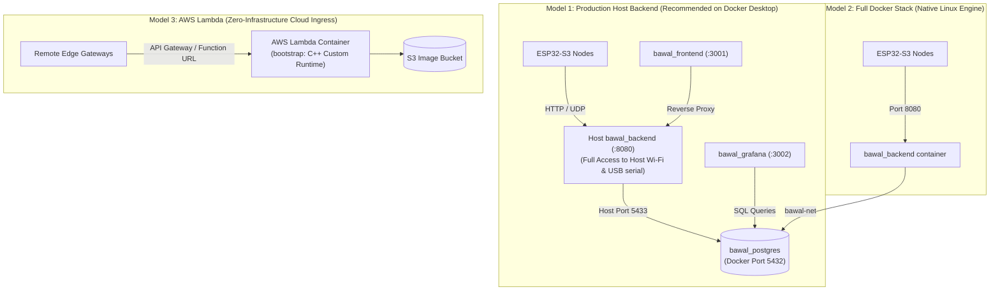

# BawalVision Deployment & Orchestration 🚢🐳

> **Industrial Multi-Architecture Deployment Stack, Edge-to-Cloud Orchestration, and AWS Lambda Packaging**  
> *Engineered for the OpenCV AI Competition 2026*

[](docker-compose.yml)
[](postgres/)
[](grafana/)
[](Dockerfile.lambda)

---

## 📑 Table of Contents
1. [Deployment Architecture](#-deployment-architecture)
2. [Port Allocation & Network Topology](#-port-allocation--network-topology)
3. [Container Stack & Dockerfile Manifest](#-container-stack--dockerfile-manifest)
4. [Storage, Volumes & Persistence](#-storage-volumes--persistence)
5. [AWS Lambda C++ Serverless Deployment](#-aws-lambda-c-serverless-deployment)
6. [Quick Start & Operational Commands](#-quick-start--operational-commands)

---

## 🏛️ Deployment Architecture

BawalVision provides two operational deployment models:



---

## 🌐 Port Allocation & Network Topology

| Service | Internal Container Port | Published Host Port | Description |
| :--- | :---: | :---: | :--- |
| **`bawal_backend`** | `8080/tcp` | **`8080/tcp`** | Crow REST API, WebSocket streams, and JPEG frame ingress. |
| **`bawal_backend`** | `8765/udp` | **`8765/udp`** | UDP Auto-discovery responder (`BAWAL_DISCOVER_V1`). |
| **`bawal_frontend`** | `3000/tcp` | **`3001/tcp`** | SvelteKit 5 Web HMI dashboard and operator portal. |
| **`bawal_grafana`** | `3000/tcp` | **`3002/tcp`** | Provisioned Grafana analytics (`GRAFANA_ADMIN_USER` / `GRAFANA_ADMIN_PASSWORD` from `.env`). |
| **`bawal_postgres`** | `5432/tcp` | **`5433/tcp`** | PostgreSQL 16 audit trail and telemetry storage. |

> **Host Port Note**: PostgreSQL publishes on host port **`5433`** (`5433:5432`) to avoid port collisions with host-installed PostgreSQL instances. Within the Docker bridge network (`bawal-net`), containers address Postgres directly via `postgres:5432`.

---

## 📦 Container Stack & Dockerfile Manifest

| Dockerfile | Target Image | Base Image | Purpose |
| :--- | :--- | :--- | :--- |
| [`Dockerfile.backend`](file:///home/fariswirakusuma/Proyekan/BawalVision/deploy/Dockerfile.backend) | `bawal-backend:latest` | `ubuntu:24.04` | Multi-stage release image compiling `bawal_backend`, libpq, ONNX Runtime CPU, OpenMP, and TeX Live PDF generator. |
| [`Dockerfile.frontend`](file:///home/fariswirakusuma/Proyekan/BawalVision/deploy/Dockerfile.frontend) | `bawal-frontend:latest` | `node:22-alpine` | Lightweight Alpine container hosting the production SvelteKit 5 web assets. |
| [`Dockerfile.vision`](file:///home/fariswirakusuma/Proyekan/BawalVision/deploy/Dockerfile.vision) | `bawal-vision:latest` | `ubuntu:24.04` | Standalone high-speed CV inspection viewer (`vision_service`). |
| [`Dockerfile.lambda`](file:///home/fariswirakusuma/Proyekan/BawalVision/deploy/Dockerfile.lambda) | `bawal-lambda:latest` | `ubuntu:24.04` | Serverless custom C++ runtime image containing `bootstrap` with AWS Lambda Runtime Interface Emulator (RIE). |

---

## 💾 Storage, Volumes & Persistence

* **`postgres_data`**: Named volume persisting inspection logs, detection bounding boxes, and system telemetry across container restarts.
* **`services/templates:/app/services/templates:ro`**: Read-only bind mount ensuring LaTeX audit report templates remain synchronized with the host without rebuilding container images.
* **`/dev/shm` tmpfs**: Containerized backend mounts a $256\text{ MB}$ POSIX shared memory buffer (`tmpfs`) to support ultra-fast zero-copy frame transfers.
* **PostgreSQL Schema**: Initialized from [`postgres/shema.sql`](file:///home/fariswirakusuma/Proyekan/BawalVision/deploy/postgres/shema.sql) upon first volume initialization.

---

## ☁️ AWS Lambda C++ Serverless Deployment

The Lambda container leverages the official **AWS Lambda C++ Runtime Interface Client (`aws-lambda-cpp`)**:

```bash
# 1. Build the Lambda container locally
docker build -f deploy/Dockerfile.lambda -t bawal-lambda:latest .

# 2. Test locally using the built-in Runtime Interface Emulator (RIE)
docker run --rm -p 8080:8080 bawal-lambda:latest

# 3. In another terminal, invoke a test inspection snapshot via curl
curl -XPOST "http://localhost:8080/2015-03-31/functions/function/invocations" \
     -d '{"image_base64": "'"$(base64 -w0 examples/0001_nasi_bento.jpg)"'"}'

# 4. Render any Markdown audit report to PDF (no TeX installation required)
curl -XPOST "http://localhost:8080/api/v1/reports/pdf" \
     -H "Content-Type: application/json" \
     -d '{"markdown":"# BawalVision Audit\n\n| Metric | Value |\n| --- | --- |\n| Verdict | ACCEPTED |","filename":"audit.pdf"}' \
     --output audit.pdf
```

* **Portable PDF Engine**: Lambda renders Markdown reports with an embedded C++ PDF writer, so `pdflatex`/`tectonic` are not required in the serverless image.
* **HTTP Authentication**: Set `BAWAL_LAMBDA_AUTH_TOKEN` (32+ characters) for `deploy_lambda.sh` and the Vercel/server proxy. The Lambda handler rejects HTTP invocations without a matching `X-Bawal-Token` (or `Authorization: Bearer <token>`); direct AWS invocations remain IAM-protected. Browser clients must call the SvelteKit `/api` proxy (or the Local Agent), not the raw Function URL, because the token is injected server-side. In Vercel, set `AWS_LAMBDA_URL` to the Function URL printed by `deploy_lambda.sh`; API Gateway `execute-api` URLs are rejected because the SvelteKit proxy does not sign SigV4. For a custom-domain Lambda Function URL, set `AWS_LAMBDA_URL` to that domain (or set `BACKEND_MODE=lambda`).
* **Security Hardening**: `deploy/Dockerfile.lambda` runs `apt-get upgrade -y` and purges unused FFmpeg video device capture packages (`libavdevice*`), ensuring **zero Critical or High CVEs** during AWS ECR Inspector scans.
* **Cold-Start Pre-Warming**: Model loading occurs during initialization before the first request, yielding warm execution times under $30\text{ ms}$.

---

## 🚀 Quick Start & Operational Commands

All stack operations are orchestrated through `just`:

```bash
# Start PostgreSQL, Frontend, and Grafana in Docker (recommended development stack)
just compose-up

# Start the C++ backend on the host against the Docker stack (enables USB/Wi-Fi scan)
just run-backend

# Run the full API automated integration test suite
just test-api

# View live container logs
just compose-logs [bawal_backend|postgres|frontend]

# Stop all containers
just compose-down
```

