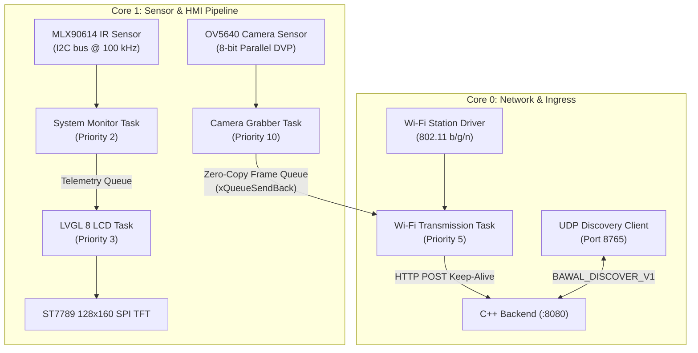

# BawalVision Edge Firmware 🔌📡

> **Deterministic FreeRTOS Firmware for ESP32-S3 Industrial Food Inspection Node**  
> *Engineered for the OpenCV AI Competition 2026*

[](https://github.com/espressif/esp-idf)
[](https://www.espressif.com/en/products/socs/esp32-s3)
[](main/src/main.c)
[](main/src/lcd_task.c)

---

## 📑 Table of Contents
1. [Firmware Architecture](#-firmware-architecture)
2. [Hardware Pinout & Wiring Specifications](#-hardware-pinout--wiring-specifications)
3. [Zero-Heap Determinism & Memory Allocation](#-zero-heap-determinism--memory-allocation)
4. [Communication & Streaming Protocols](#-communication--streaming-protocols)
   - [HTTP Keep-Alive Frame Ingress](#1-http-keep-alive-frame-ingress)
   - [UDP Auto-Discovery Protocol](#2-udp-auto-discovery-protocol-bawal_discover_v1)
   - [Streaming In-Header Telemetry](#3-streaming-in-header-telemetry)
5. [Task Partitioning & Core Affinity](#-task-partitioning--core-affinity)
6. [Building, Flashing & Monitoring](#-building-flashing--monitoring)
7. [Directory Structure](#-directory-structure)

---

## 🏛️ Firmware Architecture

The ESP32-S3 firmware coordinates concurrent high-bandwidth camera capture, contactless infrared thermal telemetry, a local operator dashboard, and network transmission:



---

## 🔌 Hardware Pinout & Wiring Specifications

Engineered for the **ESP32-S3-WROOM-1 (N16R8: 16MB Flash, 8MB Octal PSRAM)**:

| Functional Block | Signal Line | ESP32-S3 GPIO | Physical Header Pin | Electrical Notes |
| :--- | :--- | :---: | :---: | :--- |
| **ST7789 / ST7735 TFT** | `LCD_MOSI` | `GPIO 14` | Pin 19 (`IO14`) | SPI Data MOSI (40 MHz) |
| *(128 × 160 IPS Display)*| `LCD_SCK` | `GPIO 21` | Pin 37 (`IO21`) | SPI Clock SCLK |
| | `LCD_DC` | `GPIO 45` | Pin 34 (`IO45`) | Data / Command select |
| | `LCD_CS` | `GND` | Direct Ground | Tied to GND (CS-less mode) |
| | `LCD_RST` | `EN / RES`| Hardware Reset | Tied to chip enable line |
| | `LCD_BCKL` | `3V3` | Power Rail | Always-on backlight |
| **Contactless Thermal** | `I2C_SDA` | `GPIO 1` | Pin 23 (`IO1`) | 4.7 kΩ pull-up to 3.3V |
| *(GY-906 / MLX90614)* | `I2C_SCL` | `GPIO 47` | Pin 36 (`IO47`) | 4.7 kΩ pull-up to 3.3V |
| **OV5640 DVP Camera** | `CAM_XCLK` | `GPIO 15` | Pin 7 | 20 MHz Master Clock |
| *(8-bit Parallel DVP)* | `CAM_PCLK` | `GPIO 13` | Pin 18 | Pixel Clock input |
| | `CAM_VSYNC`| `GPIO 6` | Pin 5 | Vertical Frame Sync |
| | `CAM_HREF` | `GPIO 7` | Pin 6 | Horizontal Reference |
| | `CAM_SIOD` | `GPIO 4` | Pin 3 | SCCB I2C Data |
| | `CAM_SIOC` | `GPIO 5` | Pin 4 | SCCB I2C Clock |
| | `CAM_D0..D7`| `11, 9, 8, 10, 12, 18, 17, 16` | DVP Bus | 8-bit parallel pixel stream |

---

## 🛡️ Zero-Heap Determinism & Memory Allocation

To prevent heap fragmentation crashes during 24/7 industrial deployment, BawalVision firmware enforces **100% Static FreeRTOS Allocation**:

* **Static Task Stacks**: Every FreeRTOS task is provisioned via `xTaskCreateStaticPinnedToCore` with dedicated pre-allocated stack arrays (`StackType_t`).
* **Static Queues & Semaphores**: Frame buffers and telemetry channels use `xQueueCreateStatic` with static storage buffers.
* **Octal PSRAM Direct Mapping**: Large camera frame buffers (VGA $640 \times 480$ JPEG, up to 65 KB each) reside in Octal PSRAM via DMA channels without competing with FreeRTOS internal SRAM.
* **lwIP Buffer Sizing**: TCP send and receive windows (`CONFIG_LWIP_TCP_SND_BUF_DEFAULT`, `CONFIG_LWIP_TCP_WND_DEFAULT`) are clamped to `57600` bytes (strictly within the Kconfig unsigned 16-bit range $\le 65535$).

---

## 📡 Communication & Streaming Protocols

### 1. HTTP Keep-Alive Frame Ingress
The edge node maintains a persistent HTTP 1.1 connection to the C++ backend:
* Endpoint: `POST /api/v1/camera/frame`
* Content-Type: `image/jpeg`
* Sustained Frame Rate: **15–20 FPS at VGA resolution (640×480)**.
* Header metadata includes frame sequence index, hardware timestamps, and temperature sensor telemetry.

### 2. UDP Auto-Discovery Protocol (`BAWAL_DISCOVER_V1`)
When the backend IP configured in NVS is unreachable or changes due to DHCP lease renewal:
1. The ESP32 broadcasts a UDP packet `BAWAL_DISCOVER_V1` to `255.255.255.255:8765`.
2. The backend responds from [`services/src/backend/discovery.cpp`](file:///home/fariswirakusuma/Proyekan/BawalVision/services/src/backend/discovery.cpp) with its current IP address and HTTP port.
3. The board dynamically adopts the new host address without requiring a reflash.

### 3. Streaming In-Header Telemetry
While video streaming is active, JSON heartbeats are bypassed to conserve Wi-Fi bandwidth. Instead, telemetry fields are folded into standard HTTP request headers on every frame:
* `X-ESP-Temp`: Internal SoC temperature (°C).
* `X-ESP-CPU-Load`: Dual-core CPU utilization percentage.
* `X-Camera-Model`: Sensor model string (e.g., `OV5640-DVP`).

---

## ⚙️ Task Partitioning & Core Affinity

| Task Name | Core Affinity | Priority | Stack Size | Function |
| :--- | :---: | :---: | :---: | :--- |
| **`camera_task`** | **Core 1** | **10** (High) | 8,192 B | DVP DMA frame grabber, double-buffered frame flip. |
| **`wifi_stream_task`** | **Core 0** | **5** (Normal) | 12,288 B | lwIP TCP socket dispatch, keep-alive HTTP POST stream. |
| **`lcd_task`** | **Core 1** | **3** (Low) | 6,144 B | LVGL 8 RGB widget rendering and ST7789 SPI DMA transfer. |
| **`system_monitor`** | **Core 1** | **2** (Idle) | 4,096 B | I2C infrared temperature polling & SoC health watchdog. |

---

## 🚀 Building, Flashing & Monitoring

Ensure ESP-IDF v5.3+ is installed on the host machine (`export IDF_PATH=...`):

```bash
# 1. Compile firmware (auto-sources $IDF_PATH/export.sh)
just build-edge

# 2. Flash to ESP32-S3 over USB and open UART monitor
just run-edge /dev/ttyACM0

# 3. Clean edge build artifacts
cd edge && idf.py fullclean
```

> **Configuration Note**: Wi-Fi credentials (`WIFI_SSID`, `WIFI_PASS`) and backend destination (`BACKEND_IP`, `BACKEND_PORT`) are baked from root `.env` into compile definitions during CMake configuration. Changing `.env` automatically triggers an incremental rebuild.

---

## 📂 Directory Structure

```text
edge/
├── CMakeLists.txt                 # Master ESP-IDF project definition
├── sdkconfig.defaults             # Verified Kconfig defaults (PSRAM, lwIP, CPU freq)
├── main/
│   ├── CMakeLists.txt             # Component registration and .env definitions
│   ├── Kconfig.projbuild          # Custom board menu options
│   ├── include/
│   │   ├── camera_task.h          # Camera acquisition interface and buffer handles
│   │   ├── lcd_task.h            # LVGL 8 GUI dashboard task interface
│   │   ├── pins.h                # Master hardware pinout definitions
│   │   ├── system_monitor.h      # Contactless thermal and SoC health interface
│   │   └── wifi.h                # Wi-Fi station, streaming client, and UDP discovery
│   └── src/
│       ├── camera_task.c          # DVP sensor driver and queue dispatch
│       ├── lcd_task.c             # ST7789 driver and LVGL widgets
│       ├── main.c                 # FreeRTOS app_main static setup
│       ├── system_monitor.c       # I2C driver and task stack watermarks
│       └── wifi.c                 # HTTP Keep-Alive client and discovery logic
```

