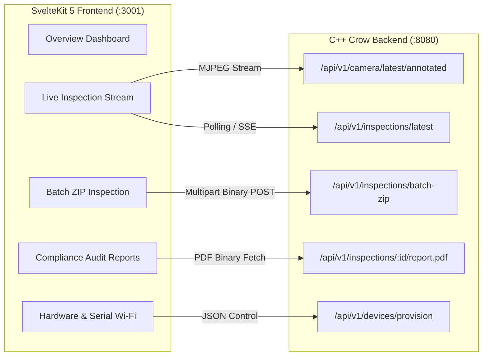

# BawalVision Frontend HMI 🖥️✨

> **Modern Human-Machine Interface (HMI) for Real-Time Industrial Food Tray Inspection**  
> *Engineered for the OpenCV AI Competition 2026*

[](https://kit.svelte.dev/)
[](tsconfig.json)
[](vite.config.ts)
[](tailwind.config.js)

---

## 📑 Table of Contents
1. [Interface Overview & Architecture](#-interface-overview--architecture)
2. [Views & Operational Capabilities](#-views--operational-capabilities)
3. [Technology Stack](#-technology-stack)
4. [Developer Workflow & Type Safety](#-developer-workflow--type-safety)
5. [Production Build & Docker Packaging](#-production-build--docker-packaging)
6. [Directory Structure](#-directory-structure)

---

## 🏛️ Interface Overview & Architecture

The frontend serves as the real-time supervision and control interface for station operators, quality inspectors, and compliance auditors. It interfaces with the C++ Crow backend over low-latency HTTP/SSE streams:



---

## 🎛️ Views & Operational Capabilities

### 1. Overview Dashboard (`/`)
* **Live KPI Counters**: Real-time pass/review/reject tray counters, hourly throughput, and mean freshness score.
* **Telemetry Gauges**: ESP32-S3 SoC temperature, dual-core CPU load, ingestion FPS, and model execution time.
* **Direct Grafana Portal Link**: Seamless single-click access to the full fleet analytics dashboard (`:3002`).

### 2. Live Inspection & Vision Stream (`/live`)
* **Real-time Detection Canvas**: 30+ FPS annotated camera feed displaying normalized bounding boxes, food class badges, confidence scores, and spoilage indicators.
* **Multi-Modal Thermal Card**: Synchronized food surface temperature readings from the edge node's MLX90614 sensor.
* **Instant Report Trigger**: One-click generation and instant preview of LaTeX compliance audit certificates.

### 3. Batch Inspection Hub (`/batch`)
* **High-Throughput Parallel Processing**: Drag-and-drop ZIP archive uploader (up to 15 MB / 50 trays).
* **OpenMP Vectorized Processing**: Real-time progress bar tracking multi-core INT8 YOLO inference and SIMD evaluation.
* **Interactive Master Report Viewer**: Deep-dive analytics table including per-class precision/recall, SIMD freshness histograms, and PDF report download.

### 4. Inspection Reports & Audit Stream (`/inspections`)
* **Audit Trail**: Paginated chronological history of every inspected tray stored in PostgreSQL.
* **Cryptographic Integrity**: Verification of 64-bit FNV-1a checksums on every audit entry.
* **Multi-Format Export**: Direct download in both compiled PDF (`X-Report-Format: pdf`) and raw LaTeX source (`X-Report-Format: tex`).

### 5. Hardware Telemetry & Provisioning (`/telemetry` & `/settings`)
* **USB Serial Auto-Provisioning**: Web Serial lets you pick any OS serial port (`COMx` on Windows, `/dev/ttyACM*` or `/dev/ttyUSB*` on Linux), including CH343/CP210x/FTDI bridges. Server-side scanning remains Linux-only.
* **Camera Sensor Calibration**: Interactive horizontal/vertical flip controls (`CAMERA_HFLIP`, `CAMERA_VFLIP`) and exposure adjustment.

---

## 💻 Technology Stack

* **Framework**: SvelteKit 5 utilizing **Runes reactivity** (`$state`, `$derived`, `$effect`) for sub-millisecond UI re-renders without virtual DOM overhead.
* **Language**: TypeScript 5 in strict mode.
* **Styling**: Tailwind CSS 3 with DaisyUI industrial dark theme components.
* **Visualization**: Chart.js for real-time telemetry line graphs and freshness distribution histograms.
* **Build Tool**: Vite 5 with automatic backend API proxying (`127.0.0.1:8080`).

---

## 🛠️ Developer Workflow & Type Safety

Recipes are managed via `Justfile` and `scripts/backend.just`:

```bash
# 1. Install npm dependencies
just install-frontend

# 2. Run TypeScript & SvelteKit typecheck (strict CI gate)
just check-frontend

# 3. Start local development server with HMR (:5173)
just run-frontend
```

> **Note on Lockfiles**: `package-lock.json` is gitignored by design to adhere to monorepo hygiene policies. Dependencies are cleanly installed via `npm install --legacy-peer-deps`.

---

## 🐳 Production Build & Docker Packaging

The frontend is containerized using a multi-stage Node build:

```bash
# Compile production assets and test the static build
cd frontend && npm run build

# Build production Docker container
docker build -f deploy/Dockerfile.frontend -t bawal-frontend:latest .
```

The containerized service runs on port `3000` (mapped to `3001` in `deploy/docker-compose.yml`) and reverse-proxies `/api` routes to the C++ Crow backend.

---

## 📂 Directory Structure

```text
frontend/
├── src/
│   ├── app.html                   # Master HTML template
│   ├── lib/                       # Shared UI components, API clients, and stores
│   │   ├── components/            # Telemetry cards, inspection badges, video canvas
│   │   └── types/                 # TypeScript interfaces matching C++ DTOs
│   └── routes/                    # SvelteKit page routes
│       ├── +layout.svelte         # Main shell navigation, sidebar, and header
│       ├── +page.svelte           # Overview dashboard
│       ├── batch/                 # High-throughput batch inspection tab
│       ├── inspections/           # Inspection history and PDF viewer
│       ├── live/                  # Real-time annotated video stream
│       └── settings/              # Device provisioning and camera config
├── static/                        # Static brand assets and fallback icons
├── tailwind.config.js             # Styling tokens and color palettes
├── tsconfig.json                  # Strict TypeScript configuration
└── vite.config.ts                 # Vite bundler and API reverse proxy
```
