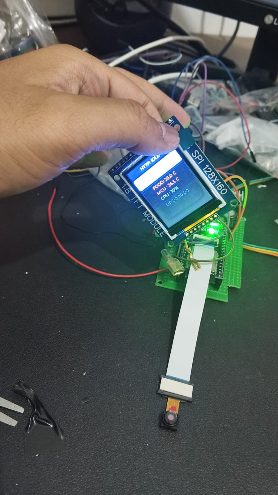
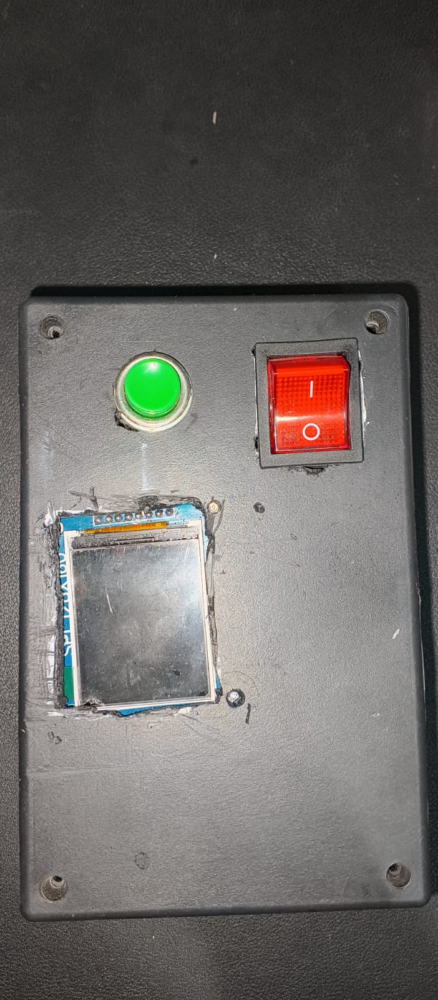
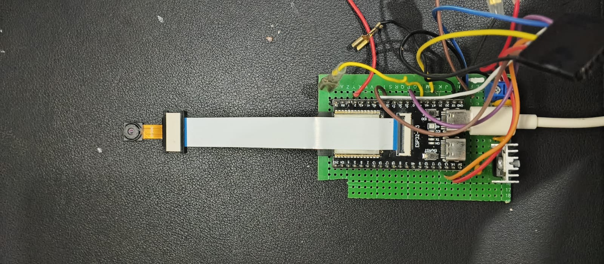
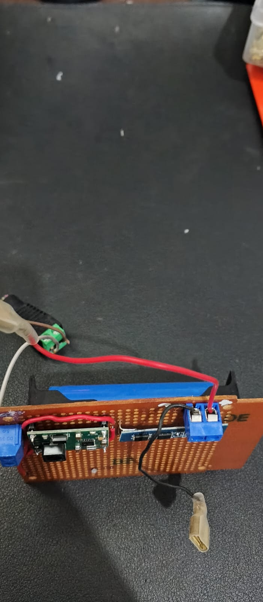
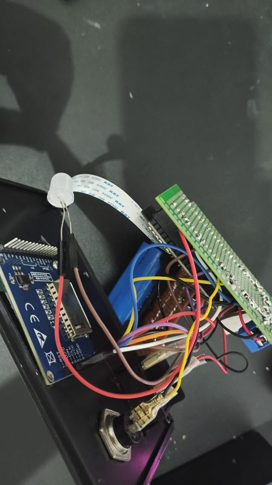

# 🛠️ BawalVision v7 Edge Hardware Specification

This directory contains the physical architecture, Bill of Materials (BOM), power distribution schematics, and photographic documentation for the **BawalVision v7 Edge Inspection Node**.

---

## 📸 Physical Device Gallery

### 1. Exterior & User Interface
| Front Panel & On-Device HUD | Top Enclosure Perspective |
|:---:|:---:|
| <br><sub>**1.8" ST7735 SPI TFT LCD** running the local LVGL 8 RGB dashboard (displaying real-time Wi-Fi IP, CPU temp, and HTTP stream status)</sub> | <br><sub>**Top Chassis View** showing camera lens aperture, inspection illumination LED push button, and rocker power switch</sub> |

---

### 2. Internal Architecture & Teardown
| FR4 Main Motherboard | FR2 Power Distribution & BMS Assembly |
|:---:|:---:|
| <br><sub>**Mainboard:** ESP32-S3-WROOM CAM module socketed on female headers with OmniVision OV3660 3MP camera sensor and ST7735 SPI bus breakout</sub> | <br><sub>**Power Assembly:** TP5100 lithium battery charger, FDC-2S-200 BMS protection board, LM7805 5V regulator with heatsink, and dual 0.7A PPTC fuses</sub> |

<br>

<div align="center">
  <h3>Full Internal Exploded Assembly</h3>
  <br>
  <sub><b>Layered Interior Teardown:</b> Modular stack separating the high-noise DC power regulation stage from the high-frequency digital camera bus.</sub>
</div>

---

## 🧾 Bill of Materials (BOM) — BawalVision v7

The complete Bill of Materials exported from [`hardware/bom/BawalVision v7.xlsx`](bom/BawalVision%20v7.xlsx):

| Reference Designator | Model / Part | Quantity | Description / Application |
|---|---|:---:|---|
| **Microcontroller** | ESP32-S3-WROOM CAM Dev Board | 1 | Dual-core Xtensa LX7 @ 240 MHz, 8 MB Octal PSRAM, 16 MB Flash |
| **CAM1** | OmniVision OV3660 | 1 | 3-Megapixel CMOS image sensor with 24-pin 0.5 mm pitch FPC interface |
| **TFT Screen** | 1.8" SPI TFT (ST7735) | 1 | 128×160 RGB display for on-device LVGL telemetry HUD |
| **IC1** | LM7805 | 1 | 5V linear voltage regulator with aluminum heatsink |
| **TP5100** | TP5100 | 1 | 2A lithium battery charge management controller |
| **FDC-2S-200** | FDC-2S-200 | 1 | 2S Lithium-Ion Battery Management System (BMS) protection board |
| **BT1** | 2S Battery Pack | 1 | Portable DC battery power pack |
| **PPTC** | Resettable PolySwitch | 2 | 0.7A in series for overcurrent & thermal cutoff protection |
| **9mm-DC-JACK** | Female DC Jack (9 mm) | 1 | External DC power input port |
| **S3** | Rocker Switch | 1 | Master power ON/OFF switch |
| **S1** | Pushbutton Switch | 1 | Inspection illumination trigger switch |
| **D1** | White LED | 1 | Food tray target area lighting |
| **C** | Ceramic Capacitor | 2 | Decoupling capacitors |
| **Thermal Putty** | Thermal interface compound | 1 tub | PPTC thermal coupling & heat management |
| **Pin Header** | 2.54 mm Female Header | 1 set | Socket mount for ESP32-S3 CAM development board |
| **Terminal Block** | 2-pin Screw Terminal (1×2) | 3 | Modular wire interconnects |
| **Perfboard** | Prototyping Board | 2 | FR2 for power assembly, FR4 for motherboard |
| **Hardware** | Nuts, bolts, standoffs, cabling | Assorted | Chassis standoffs, mechanical fasteners, and hookup wires |
| **Enclosure** | Generic Electronic Box | 1 | Enclosure with cutouts for LCD, camera, switches, and DC jack |

---

## ⚡ Power System Architecture

```text
[ 9mm DC Input Jack ]
         │
         ▼
  [ TP5100 Charger ] ──► [ FDC-2S-200 BMS ] ──► [ 2S Battery Pack ]
                                 │
                                 ▼
                         [ Rocker Switch S3 ]
                                 │
                     [ Dual 0.7A PPTC Fuses ]
                                 │
                     [ LM7805 + Heatsink (5V) ]
                                 │
            ┌────────────────────┴────────────────────┐
            ▼                                         ▼
   [ ESP32-S3-WROOM CAM ]                    [ 1.8" ST7735 TFT LCD ]
            │
    [ OV3660 Camera ]
```

1. **Dual Power Modes:** Supports external DC barrel-jack supply (9mm) or untethered operation via the onboard 2S Li-Ion battery pack.
2. **Charging & Protection:** Handled via the TP5100 2A buck-charging controller coupled to an FDC-2S-200 BMS module to prevent over-discharge, over-charge, and short circuits.
3. **Thermal & Overcurrent Protection:** Dual 0.7A PPTC resettable fuses coupled with thermal putty cut off power in abnormal load conditions.
4. **Stable 5V Rail:** Regulated via a heatsinked LM7805 supplying clean 5V to the ESP32-S3 module and ST7735 display backlight.

---

## 🔌 Hardware Pinout Mapping

Mapped directly from [`edge/main/include/pins.h`](../edge/main/include/pins.h):

| Subsystem | Signal | GPIO | Hardware Pin / Description |
|---|---|:---:|---|
| **ST7735 1.8" TFT** | `LCD_MOSI` | `GPIO 14` | Pin 19 (`IO14` / SPI Data) |
| | `LCD_SCK` | `GPIO 21` | Pin 37 (`IO21` / SPI Clock) |
| | `LCD_DC` | `GPIO 45` | Pin 34 (`IO45` / Data-Command Select) |
| | `LCD_RST` | `GPIO 39` | Pin 39 (`IO39` / Display Hardware Reset) |
| | `LCD_BCKL` | `GPIO 38` | Pin 38 (`IO38` / Display Backlight Control) |
| | `LCD_CS` | `-1` | Tied to `GND` (Direct Ground, CS-less mode) |
| **Controls & Lighting** | `PIN_BTN_TRIGGER` | `GPIO 48` | External inspection tact switch (Active LOW) |
| | `PIN_LED_FLASH` | `GPIO 2` | Pin 24 (`IO2` / Illumination LED trigger) |
| | `PIN_BTN_BOOT` | `GPIO 0` | Pin 33 (`IO0` / Bootloader mode switch) |
| **OV3660 Camera DVP** | `CAM_XCLK` | `GPIO 15` | Pin 7 (`IO15` / 20 MHz Master Clock) |
| | `CAM_PCLK` | `GPIO 13` | Pin 18 (`IO13` / Pixel Clock) |
| | `CAM_VSYNC` | `GPIO 6` | Pin 5 (`IO6` / Vertical Sync) |
| | `CAM_HREF` | `GPIO 7` | Pin 6 (`IO7` / Horizontal Reference) |
| | `CAM_SIOD` | `GPIO 4` | Pin 3 (`IO4` / SCCB SDA) |
| | `CAM_SIOC` | `GPIO 5` | Pin 4 (`IO5` / SCCB SCL) |
| | `CAM_D0..D7` | `11, 9, 8, 10, 12, 18, 17, 16` | 8-bit Parallel DVP Data Bus (`Y2..Y9`) |
| | `CAM_PWDN` | `-1` | Tied to `GND` |
| | `CAM_RESET` | `-1` | Tied to `3V3` |

