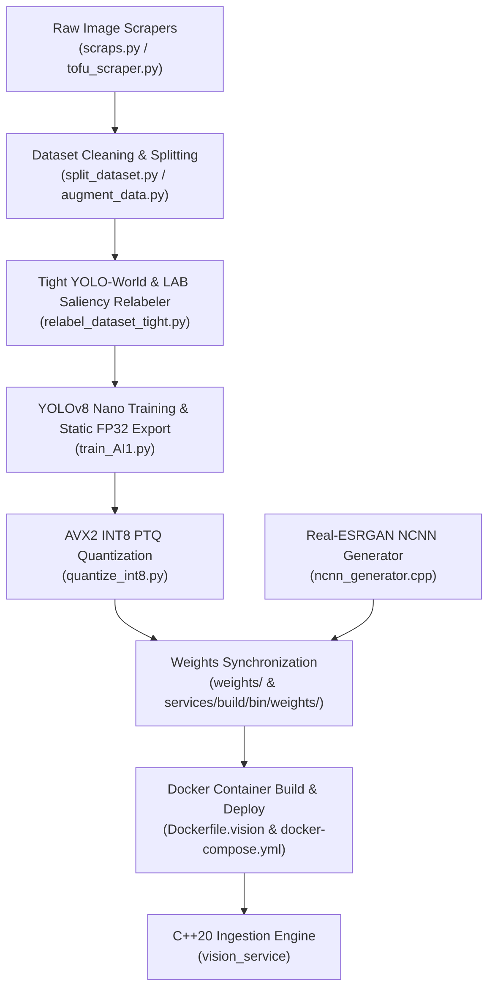

# BawalVision Machine Learning & Vision Pipeline Guide

Comprehensive engineering handbook for dataset preparation, zero-shot annotation, YOLOv8 training, AVX2-optimized INT8 post-training quantization (PTQ), Real-ESRGAN super-resolution generation, and production Docker deployment.

---

## Architecture & Workflow Overview



### The 9 Target Food Categories (Indonesian School Lunch / MBG)
| Class ID | Name | Semantic Description | Key Visual Characteristics |
| :---: | :--- | :--- | :--- |
| **0** | `banana` | Banana (*Pisang*) | Yellow skin, curved cylindrical fruit, sliced or whole |
| **1** | `chicken` | Chicken (*Ayam*) | Fried drumstick, crispy golden-brown meat, roasted breast |
| **2** | `egg` | Egg (*Telur*) | Boiled egg halves, sunny-side up, fried round edges |
| **3** | `orange` | Orange (*Jeruk*) | Citrus sphere, bright orange peel, segmented citrus |
| **4** | `rice` | White Rice (*Nasi Putih*) | Cooked grain mound, textured white pile |
| **5** | `spinach` | Spinach (*Bayam*) | Cooked dark green leaves, tender textured greens |
| **6** | `tempeh` | Tempeh (*Tempe*) | Textured fermented soybean cake, fried golden rectangular slice |
| **7** | `tofu` | Tofu (*Tahu*) | Smooth pale cube, fried golden puff cube |
| **8** | `water_spinach` | Water Spinach (*Kangkung*) | Elongated hollow green stems, stir-fried leaves |

---

## Stage-by-Stage Operational Walkthrough

### Stage 1: Data Scraping & Web Gathering
Collect diverse, high-resolution food images representing Indonesian school meal components across various lighting conditions, angles, and tableware.

```bash
# Scrape food categories using Bing/iCrawler engines
python ml/scrap/scraps.py

# Specialized scraper for tofu variants (white, fried, yellow)
python ml/scrap/tofu_scraper.py
```

#### What to Check & Key Concerns:
* **Watermarks & Stock Overlays**: Discard images with heavy watermarks (Getty, Shutterstock, Alamy) as they bias convolutional filters.
* **Aspect Ratio & Resolution**: Eliminate images smaller than $300 \times 300$ pixels.
* **Category Contamination**: Ensure web scraping terms do not pull non-food items (e.g., live chickens, orange flowers, rubber bananas).
* **Storage Path**: Save raw scraped images into structured class folders under `ml/dataset/<category_name>/`.

---

### Stage 2: Data Cleaning, Augmentation & Train/Val Splitting
Prepare clean 80/20 train/val splits and apply subtle geometric/photometric augmentations.

```bash
# Split raw dataset into structured train/val folders
python ml/split_dataset.py

# Optional: Generate targeted augmentations for underrepresented classes
python ml/augment_data.py
```

#### What to Check & Key Concerns:
* **No Train/Val Data Leakage**: Identical or nearly identical burst shots of the same plate must NOT be split across train and val.
* **Directory Structure**: Verify that the split directory looks like:
  ```
  ml/AI1/dataset/
  ├── train/
  │   ├── banana/
  │   ├── chicken/
  │   └── ... (9 classes)
  └── val/
      ├── banana/
      └── ... (9 classes)
  ```

---

### Stage 3: High-Precision Tight Dataset Relabeling (Zero-Dummy & Multi-Box)
Replaces uncalibrated loose bounding boxes with tight zero-shot YOLO-World detections and LAB color saliency contours.

```bash
# Run high-precision zero-shot multi-box relabeling
python ml/AI1/relabel_dataset_tight.py
```

#### What to Check & Key Concerns:
* **CRITICAL: Zero `(0.5, 0.5, 0.55, 0.55)` Dummy Fallbacks**:
  * Never write a static centered box if detection is uncertain. If an image has no detectable food foreground, `relabel_dataset_tight.py` leaves an empty `.txt` file.
  * *Audit Check*: After running, check `ml/AI1/yolo_dataset/labels/train/`. Search for static boxes:
    ```bash
    grep -rn "0.500000 0.500000 0.550000 0.550000" ml/AI1/yolo_dataset/labels/
    ```
    *Result must be empty (0 matches).*
* **Multi-Box Handling**:
  * Ensure dishes with multiple pieces (e.g., 2 bananas or 3 tempeh slices) produce multiple label rows per `.txt` file instead of truncating to `valid[0]`.
* **Disjoint Class Prompts**:
  * Verify `CLASS_TAXONOMY` does not use overlapping prompts (e.g., generic `"vegetable dish"` or `"food"`), keeping `spinach` strictly differentiated from `water_spinach`, and `tempeh` from `tofu`.

---

### Stage 4: YOLOv8n Training & Static FP32 ONNX Export
Train the YOLOv8 Nano backbone optimized for real-time edge CPU inference.

```bash
# Train YOLOv8n with optimal MBG hyperparameters
python ml/AI1/train_AI1.py --epochs 120 --batch-size 8
```

#### Key Hyperparameters (`train_AI1.py`):
* `cls=0.5`: Balanced classification penalty (prevents squishing F1-confidence curves).
* `box=7.5`, `dfl=1.5`: Precise regression weighting for tight plate contours.
* `mosaic=1.0`, `mixup=0.1`, `close_mosaic=15`: Disables heavy mosaic distortion during the final 15 epochs for clean bounding box convergence.
* `shear=2.0`, `scale=0.5`: Subtle affine transformations suited for small food portion variance.
* `dynamic=False`, `simplify=True`, `opset=13`: Exports a clean static shape ONNX graph.

#### What to Check & Key Concerns:
1. **Audit `runs/ai1_yolov8n_det/labels.jpg`**:
   * Inspect the `x vs y` and `width vs height` scatter plots.
   * *Pass Condition*: Evenly distributed cluster representing various plate positions. **No concentrated single dot** at `(0.5, 0.5)` with dimensions `(0.55, 0.55)`.
2. **Audit `runs/ai1_yolov8n_det/confusion_matrix.png`**:
   * Look at the rightmost column (`True: background`).
   * *Pass Condition*: Background false positives must be minimal (< 50 across validation set, down from previous 1,000+).
   * Diagonal true-positive accuracy across all 9 classes should exceed $0.80$ ($80\%$).
3. **Audit `runs/ai1_yolov8n_det/results.jpg`**:
   * `val/cls_loss` should steadily decline below $1.0$ without early plateauing at $1.50$.
   * `mAP50` should reach $\ge 0.85$ ($85\%$).
4. **PyTorch vs ONNX Parity Sanity Check**:
   * The training script automatically executes a numerical parity check against ONNX Runtime:
     ```
     -> Peak Absolute Delta : < 0.001
     -> Mean Absolute Delta : < 0.0001
     [✓] Sanity check PASSED!
     ```

---

### Stage 5: Low-RAM Post-Training Quantization (INT8 AVX2-Ready)
Converts the FP32 ONNX model into an 8-bit quantized QDQ graph calibrated for Intel/AMD AVX2 SIMD instructions.

```bash
# Run low-RAM (<400 MB) INT8 quantization
python ml/AI1/quantize_int8.py
```

#### What to Check & Key Concerns:
* **AVX2 Native Format (`VPMADDUBSW`)**:
  * `weight_type=QuantType.QInt8` (`WeightSymmetric: True`)
  * `activation_type=QuantType.QUInt8` (`ActivationSymmetric: False`)
  * This matches AVX2 hardware requirements (unsigned activation $\times$ signed weights) and eliminates runtime sign-extension overhead.
* **Preserve Full Dynamic Range**:
  * Ensure `reduce_range=False` and `per_channel=True`.
  * *Warning*: Setting `reduce_range=True` truncates resolution to 7 bits (64 levels), which drops model confidence from $70\%$ to $< 40\%$.
* **RAM Management & Anti-Crash Protocol**:
  * Uses `CalibrationMethod.MinMax` and `max_samples=50` with explicit `del` and `gc.collect()`.
  * Never switch to `CalibrationMethod.Entropy` or `Percentile` on resource-constrained workstations, as they store full activation tensors and exceed 10 GB RAM.
* **Detection Head Protection**:
  * `get_head_nodes_to_exclude` traverses 5 layers backward from `output0` and excludes `model.22`, `dfl`, `model.15`, `model.18`, and `model.21`.
  * *Audit Check*: The script prints:
    ```
    [+] Mengecualikan ~50-80 node sensitif/head agar presisi bbox & confidence tetap FP32.
    -> Sampel Uji Max Confidence (FP32) : 0.7xxx
    -> Sampel Uji Max Confidence (INT8) : 0.6xxx - 0.7xxx
    ```
    *Pass Condition*: Confidence drop between FP32 and INT8 must be $\le 8\%$.

---

### Stage 6: Real-ESRGAN Super-Resolution Weights
Ensure pre-trained NCNN super-resolution binaries are generated and synchronized.

```bash
# Compile and run NCNN generator utility (if weights are missing)
g++ -std=c++20 -O3 -I ml/include ml/src/ncnn_generator.cpp ml/ncnn_generator.cpp -o ml/ncnn_generator
./ml/ncnn_generator weights/
```

#### What to Check:
* Verify file sizes under `weights/`:
  * `weights/realesr-animevideov3-x2.bin` $\approx 1.2\text{ MB}$
  * `weights/realesr-animevideov3-x2.param` $\approx 3.1\text{ KB}$
  * *Warning*: File sizes $< 1\text{ KB}$ indicate empty synthetic stubs and will trigger C++ cubic interpolation fallbacks.

---

### Stage 7: Production Weights Synchronization
The quantization script automatically copies `ai1_vision_int8.onnx` into all deployment locations. Verify paths:

```bash
ls -lh weights/ai1_vision_int8.onnx
ls -lh ml/AI1/model/yolov8n_int8/ai1_vision_int8.onnx
ls -lh services/build/bin/weights/ai1_vision_int8.onnx (if native build exists)
```

---

### Stage 8: Docker Rebuild & Service Restart
Build the container images with Highway SIMD dependencies and launch the backend ecosystem.

```bash
# 1. Rebuild vision service container
docker compose build vision

# 2. Or rebuild Intel oneAPI optimized image
docker compose -f deploy/docker-compose.oneapi.yml build vision-oneapi

# 3. Restart services
docker compose up -d vision

# 4. Stream and verify container runtime logs
docker compose logs -f vision
```

#### What to Check in Docker Logs:
* **Model Discovery**:
  ```
  [Pipeline] Loading detection model: /app/weights/ai1_vision_int8.onnx
  [FoodClassifier] Model loaded successfully with ONNX Runtime CPU Execution Provider
  ```
* **Super-Resolution Engine**:
  ```
  [Pipeline] RealESRGAN engine initialized: realesr-animevideov3-x2 (2x, CPU-only)
  [INFO] Super-Resolution Enhancer: Active (NCNN Vulkan / Multi-Arch SIMD) | Scale: 2x
  ```
* **No Permission Denied Warnings**:
  * Check that directory `/app/weights` has read/write permissions for `visionuser` (configured via `chmod -R 777 /app/weights` in `Dockerfile.vision`).
* **Health & Ingestion Verification**:
  ```bash
  # Check backend device discovery
  curl -s http://localhost:8080/api/v1/devices | jq .

  # Verify latest telemetry
  curl -s http://localhost:8080/api/v1/inspection/latest | jq .
  ```

---

## Troubleshooting & Diagnostic Matrix

| Symptom | Root Cause | Solution |
| :--- | :--- | :--- |
| `labels.jpg` has dense blue dot at `(0.5, 0.5)` | Blind `(0.5, 0.5, 0.55, 0.55)` fallback triggered during relabeling | Run `python ml/AI1/relabel_dataset_tight.py`. It writes empty files for uncertain images instead of fake boxes. |
| Background false positives $> 500$ in confusion matrix | Dummy boxes forced model to memorize plate/table textures as food items | Re-train model using cleaned labels from `relabel_dataset_tight.py`. |
| Spinach & Water Spinach confused ($> 30\%$) | Semantic overlap in YOLO-World text prompts (`"vegetable dish"`) | Check `CLASS_TAXONOMY` in `relabel_dataset_tight.py`; prompts are now disjoint. |
| Model confidence drops from $71\%$ to $< 40\%$ in INT8 | `reduce_range=True` was active, reducing INT8 to 7-bit resolution | Ensure `reduce_range=False` and `per_channel=True` in `quantize_int8.py`. |
| VS Code or System crashes (OOM Killer) during quantization | `CalibrationMethod.Entropy` or `max_samples > 100` consumed all system RAM | Use `CalibrationMethod.MinMax` and `max_samples=50` with `gc.collect()`. |
| Docker build fails: `hwy REQUIRED not found` | `libhwy-dev` missing from Stage 1 (builder) in `Dockerfile.vision` | Ensure `libhwy-dev` is installed in Stage 1 `apt-get install`. |
| `[RealESRGAN] WARNING: Falling back to cv::resize INTER_CUBIC` | `realesr-animevideov3-x2.bin` is missing or is an empty placeholder ($< 1\text{ KB}$) | Run `./ml/ncnn_generator weights/` or restore weights from `scripts/download_weights.sh`. |
| Docker runtime warning: `cannot create directories: Permission denied [/app/weights]` | Host volume mounted with non-root ownership masking container path | Verify `chmod -R 777 /app/weights` and container user permissions in `Dockerfile.vision`. |

---

## Production Verification Checklist

Before submitting code or deploying updates to production, verify all checkboxes:

- [ ] **Labels Verified**: Grep confirms 0 occurrences of `0.550000 0.550000` in `ml/AI1/yolo_dataset/labels/`.
- [ ] **Training Convergence**: `val/cls_loss` stabilizes below $1.0$ and `mAP50` exceeds $0.85$ in `results.csv`.
- [ ] **Parity Check Passed**: `train_AI1.py` completes PyTorch vs ONNX sanity check with delta $< 10^{-3}$.
- [ ] **INT8 Confidence Verified**: Test inference in `quantize_int8.py` shows confidence $\ge 0.65$ on target foods.
- [ ] **AVX2 Instructions Compatible**: ONNX graph contains `QuantizeLinear`/`DequantizeLinear` with unsigned uint8 activations and signed int8 weights.
- [ ] **Stage 1 Highway Support**: `deploy/Dockerfile.vision` and `deploy/Dockerfile.vision.oneapi` contain `libhwy-dev` in builder stage.
- [ ] **Clean Container Logs**: `docker compose logs vision` confirms ONNX Runtime CPU provider initialized without fallback warnings.

