# BawalVision Machine Learning & Vision Pipeline Guide

Comprehensive engineering handbook for dataset preparation, zero-shot annotation, YOLOv8 training, incremental fine-tuning (transfer learning), AVX2-optimized INT8 post-training quantization (PTQ), Real-ESRGAN super-resolution generation, and production Docker deployment.

---

## Architecture & Workflow Overview

```mermaid
flowchart TD
    A["Raw Image Scrapers<br/>(scraps.py / tofu_scraper.py)"] --> B["Dataset Cleaning & Splitting<br/>(split_dataset.py / augment_data.py)"]
    A2["Hard-Negative Plate Scraper<br/>(dish_scraper.py)"] -->|0-byte negative labels| B
    B --> C["Tight YOLO-World & LAB Saliency Relabeler<br/>(relabel_dataset_tight.py)"]
    C --> D["Cold Training (YOLOv8s)<br/>(train_AI1.py)"]
    D --> E["Trained Checkpoint<br/>(best.pt / ai1_vision.onnx)"]
    E --> F["Incremental Fine-Tuning<br/>Backbone Freezing: Layer 0-9<br/>(finetune_AI1.py)"]
    F --> E
    E --> G["AVX2 INT8 PTQ Quantization<br/>(quantize_int8.py)"]
    G --> H["Weights Synchronization<br/>(weights/ & services/build/bin/weights/)"]
    I["Real-ESRGAN NCNN Generator<br/>(ncnn_generator.cpp)"] --> H
    H --> J["Docker Container Build & Deploy<br/>(Dockerfile.vision & docker-compose.yml)"]
    J --> K["C++20 Ingestion Engine<br/>(vision_service / bawal_backend)"]
```



### The 9 Target Food Categories (Indonesian School Lunch / MBG)
| Class ID | Name | Semantic Description | Key Visual Characteristics |
| :---: | :--- | :--- | :--- |
| **0** | `banana` | Banana (*Pisang*) | Yellow skin, curved cylindrical fruit, sliced or whole |
| **1** | `chicken` | Chicken (*Ayam*) | Fried drumstick, crispy golden-brown meat, roasted breast |
| **2** | `egg` | Egg (*Telur*) | Boiled egg halves, sunny-side up, fried round edges |
| **3** | `orange` | Orange (*Jeruk*) | Citrus sphere, bright orange peel, segmented citrus |
| **4** | `rice` | White Rice (*Nasi Putih*) | Cooked grain mound, textured white pile |
| **5** | `spinach` | Spinach (*Bayam*) | Cooked dark green leaves, tender textured greens |
| **6** | `tempeh` | Tempeh (*Tempe*) | Textured fermented soybean cake, fried golden rectangular slice |
| **7** | `tofu` | Tofu (*Tahu*) | Smooth pale cube, fried golden puff cube |
| **8** | `water_spinach` | Water Spinach (*Kangkung*) | Elongated hollow green stems, stir-fried leaves |

*(Optional Class 9: `apple` / Apel — auto-integrated via `ml/AI1/integrate_apple_dataset.py`)*

---

## 🛠️ Quick-Reference Task Runner (`just`)

All machine learning tasks are wrapped in [`scripts/ml.just`](../scripts/ml.just) for cross-platform execution:

| Operation | `just` Shortcut | Direct Python CLI Equivalent |
| :--- | :--- | :--- |
| **Environment Setup** | `just setup-ml` | `python -m venv .venv && pip install -r ml/requirements.txt` |
| **Food Scraper** | `just scrap-dataset all 1000` | `python ml/scrap/scraps.py --category all --target-count 1000` |
| **Hard Negatives (Plates)** | `just scrap-dish piring 1000` | `python ml/scrap/dish_scraper.py --category piring --target 1000 --inject-negatives` |
| **Dataset Splitter** | `just split-dataset` | `python ml/split_dataset.py --source-dir ml/dataset/dataset_mbg_matang` |
| **Train Augmentation** | `just augment-train 500` | `python ml/augment_data.py --target-count 500` |
| **Zero-Shot Relabeling** | `just prepare-yolo-ai1 16` | `python ml/AI1/prepare_yolo_dataset.py --batch-size 16` |
| **Cold Model Training** | `just train-ai1 120 8` | `python ml/AI1/train_AI1.py --epochs 120 --batch-size 8` |
| **Incremental Fine-Tuning** | `just finetune-ai1` | `python ml/AI1/finetune_AI1.py --weights ml/AI1/model/yolov8s/best.pt --freeze 10 --lr0 0.0002` |
| **INT8 PTQ Quantization** | `just quantize-ai1` | `python ml/AI1/quantize_int8.py` |
| **NCNN Super-Resolution** | `just generate-ncnn-cpp` | `g++ -std=c++20 ... && ./ml/ncnn_generator weights/` |
| **ONNX Model Parity Test** | `just test-model-ai1` | `python -c "import onnxruntime as ort; ..."` |
| **End-to-End Pipeline** | `just pipeline-ai1` | Runs gather $\to$ split $\to$ augment $\to$ annotate $\to$ train $\to$ deploy |

---

## Stage-by-Stage Operational Walkthrough

### Stage 1: Data Scraping & Hard-Negative Gathering
Collect diverse, high-resolution food images representing Indonesian school meal components, along with clean tableware (hard negatives) to eliminate background false positives.

```bash
# 1. Scrape food categories using Bing/Google/Baidu engines
just scrap-dataset category="all" target="1000"
# (or: python ml/scrap/scraps.py)

# 2. Specialized scraper for tofu variants (white, fried, yellow)
python ml/scrap/tofu_scraper.py

# 3. CRITICAL: Hard-negative tableware scraper (clean plates/trays)
just scrap-dish category="piring" target="1000"
# (or: python ml/scrap/dish_scraper.py --inject-negatives)
```

#### What to Check & Key Concerns:
* **Empty Plate Negative Injection**: `dish_scraper.py` injects **0-byte `.txt` label files** into `ml/AI1/yolo_dataset/labels/train/`. This teaches YOLO that bare plates and tray dividers are strictly non-food background.
* **Watermarks & Stock Overlays**: Discard images with heavy watermarks (Getty, Shutterstock, Alamy) as they bias convolutional filters.
* **Aspect Ratio & Resolution**: Eliminate images smaller than $200 \times 200$ pixels.
* **Category Contamination**: Ensure web scraping terms do not pull non-food items (e.g., live chickens, orange flowers, rubber bananas).

---

### Stage 2: Data Cleaning, Augmentation & Train/Val Splitting
Prepare clean 70/15/15 stratified splits and apply domain-specific augmentations exclusively to the training set.

```bash
# Split raw dataset into leak-free train/val/test folders
just split-dataset
# (or: python ml/split_dataset.py)

# Apply domain-specific augmentations to training set only
just augment-train target="500"
# (or: python ml/augment_data.py)
```

#### What to Check & Key Concerns:
* **Zero Train/Val Data Leakage**: Perceptual dHash and MD5 deduplication (`hamming_distance <= 4`) prevent identical burst shots of the same dish from spanning train and val.
* **Train-Only Augmentations**: `augment_data.py` must never modify `val/` or `test/`. Category-specific policies:
  * `transform_greenery`: Mild color jitter and rotations for leafy vegetables (`spinach`, `water_spinach`).
  * `transform_tempeh`: Restrained rotation ($\pm 15^\circ$) to preserve fermented soybean textures.
  * `transform_protein`: Contrast adjustments and horizontal flips for meats and tofu.

---

### Stage 3: High-Precision Tight Dataset Relabeling (Zero-Dummy & Multi-Box)
Replaces uncalibrated loose bounding boxes with tight zero-shot YOLO-World v2 detections and LAB color saliency contours.

```bash
# Run high-precision zero-shot multi-box relabeling
python ml/AI1/relabel_dataset_tight.py
# (or: just prepare-yolo-ai1)
```

#### What to Check & Key Concerns:
* **CRITICAL: Zero `(0.5, 0.5, 0.55, 0.55)` Dummy Fallbacks**:
  * Never write a static centered box if detection is uncertain. If an image has no detectable food foreground, `relabel_dataset_tight.py` leaves an empty `.txt` file.
  * *Audit Check*: After running, verify label integrity:
    ```bash
    grep -rn "0.500000 0.500000 0.550000 0.550000" ml/AI1/yolo_dataset/labels/
    ```
    *Result must be empty (0 matches).*
* **Multi-Box Handling**: Dishes with multiple pieces (e.g., 2 bananas or 3 tempeh slices) produce multiple label rows per `.txt` file with IoU deduplication.
* **Disjoint Class Prompts**: Indonesian culinary synonyms ensure `spinach` (*bayam*) is strictly differentiated from `water_spinach` (*kangkung*), and `tempeh` from `tofu`.

---

### Stage 4: YOLOv8s Training & Static FP32 ONNX Export (Cold Training)
Train the primary YOLOv8s object detector from scratch with balanced MBG loss weightings.

```bash
# Train YOLOv8s detector from scratch
just train-ai1 epochs="120" batch="8"
# (or: python ml/AI1/train_AI1.py --epochs 120 --batch-size 8)
```

#### Key Hyperparameters (`train_AI1.py`):
* `MODEL_ARCH="yolov8s.pt"`: YOLOv8 Small architecture for enhanced feature resolution on small food portions.
* `box=5.5`, `cls=0.8`, `dfl=1.5`: Balanced classification penalty to sustain $\ge 80\%$ confidence scores.
* `mosaic=1.0`, `mixup=0.1`, `close_mosaic=15`: Disables mosaic distortion during the final 15 epochs for clean bounding box convergence.
* `degrees=10.0`, `shear=2.0`, `perspective=0.0`: Calibrated for top-down tray camera angles.
* `dynamic=False`, `simplify=True`, `opset=13`: Exports a clean static shape ONNX graph (`[1, 3, 640, 640]`) compatible with OpenCV DNN and ONNX Runtime C++.

#### What to Check & Key Concerns:
1. **Audit `runs/ai1_yolov8s_det/confusion_matrix.png`**:
   * Background false positives should be $< 50$ across the validation set.
   * Diagonal true-positive accuracy across all 9 classes should exceed $0.80$ ($80\%$).
2. **Audit `runs/ai1_yolov8s_det/results.png`**:
   * `val/cls_loss` should decline steadily below $1.0$.
   * `mAP50` should reach $\ge 0.85$ ($85\%$) and `mAP50-95` $\ge 0.65$.
3. **Parity Sanity Check**:
   * `train_AI1.py` automatically performs numerical parity check against ONNX Runtime CPU:
     ```
     -> Peak Absolute Delta : < 0.001
     -> Mean Absolute Delta : < 0.0001
     [✓] Sanity check PASSED!
     ```

---

### Stage 4b: Incremental Fine-Tuning & Layer Freezing (`finetune_AI1.py`)
Specialized transfer learning pipeline for incrementally updating an existing trained checkpoint (`best.pt`) with new data, hard negatives, or newly integrated food classes without catastrophic forgetting.

```bash
# Fine-tune YOLOv8s model with backbone layer freezing
just finetune-ai1 weights="ml/AI1/model/yolov8s/best.pt" epochs="30" batch="8" lr="0.0002" freeze="10"
# (or: python ml/AI1/finetune_AI1.py --weights ml/AI1/model/yolov8s/best.pt --freeze 10 --lr0 0.0002)
```

#### When to Use Fine-Tuning vs Cold Training:
| Scenario | Recommended Approach | Reason |
| :--- | :--- | :--- |
| **New Dataset / Complete Architecture Change** | Cold Training (`train_AI1.py`) | Re-learns full representation weights across all layers. |
| **Injected Hard-Negative Plates (`dish_scraper.py`)** | Fine-Tuning (`finetune_AI1.py`) | Rapidly suppresses false positives in 20-30 epochs without retraining from scratch. |
| **Adding a New Food Category (e.g., `apple`)** | Fine-Tuning (`finetune_AI1.py`) | Adapts detection head while preserving existing 9-class feature extractors. |
| **Calibrating Ambiguous Classes (Tofu vs Tempeh)** | Fine-Tuning (`finetune_AI1.py`) | Fine-tunes high-level classification weights with subtle learning rate. |

#### Key Mechanics of `finetune_AI1.py`:
1. **Backbone Freezing (`--freeze 10`)**: Freezes layers 0 through 9 (the complete YOLO backbone). Keeps edge, texture, and contour extractors locked, updating only Neck and Head layers (`model.10` through `model.22`).
2. **Gentle Learning Rate (`lr0=0.0002`, `lrf=0.05`)**: Reduces learning rate by $5\times$ compared to cold training, preventing catastrophic forgetting of previously mastered classes.
3. **Automated Static ONNX Re-export**: Automatically exports the newly fine-tuned weights to static ONNX (`ai1_vision.onnx` and `yolov8s.onnx`) with opset 13 and verifies ONNX Runtime CPU inference.

---

### Stage 4c: Integrating New Food Classes (Apple Integration Example)
To expand beyond the 9 standard MBG classes, use automated integrators such as [`ml/AI1/integrate_apple_dataset.py`](AI1/integrate_apple_dataset.py):

```bash
# Place raw fruit photos in dataset folder, then run:
python ml/AI1/integrate_apple_dataset.py --source ml/dataset/raw_apples
```

* Automatically applies zero-shot YOLO-World bounding box generation for Class ID 9 (`apple`).
* Partitions into stratified 80/10/10 splits.
* Automatically updates `ml/AI1/yolo_dataset/dataset.yaml` to 10 classes and triggers fine-tuning.

---

### Stage 5: Low-RAM Post-Training Quantization (INT8 AVX2-Ready)
Converts the FP32 ONNX model into an 8-bit quantized QDQ graph calibrated for Intel/AMD AVX2 SIMD instructions (`VPMADDUBSW`).

```bash
# Run low-RAM (<400 MB) INT8 quantization
just quantize-ai1
# (or: python ml/AI1/quantize_int8.py)
```

#### What to Check & Key Concerns:
* **AVX2 Native Format (`VPMADDUBSW`)**:
  * `weight_type=QuantType.QInt8` (`WeightSymmetric: True`)
  * `activation_type=QuantType.QUInt8` (`ActivationSymmetric: False`)
  * Matches AVX2 instruction specifications (unsigned activation $\times$ signed weights) and eliminates runtime sign-extension overhead.
* **Preserve Full Dynamic Range**:
  * Ensure `reduce_range=False` and `per_channel=True`.
  * *Warning*: Setting `reduce_range=True` truncates resolution to 7 bits (64 levels), which drops model confidence from $70\%$ to $< 40\%$.
* **RAM Management & Anti-Crash Protocol**:
  * Uses `CalibrationMethod.MinMax` with `max_samples=50` and explicit `del` + `gc.collect()`.
  * Memory footprint stays below $400\text{ MB}$, avoiding system OOM crashes.
* **Detection Head Protection**:
  * `get_head_nodes_to_exclude` traverses 5 layers backward from `output0` and excludes `model.22`, `dfl`, `model.15`, `model.18`, and `model.21`.
  * *Pass Condition*: Confidence drop between FP32 and INT8 must be $\le 8\%$.
    ```
    -> Sampel Uji Max Confidence (FP32) : 0.7xxx
    -> Sampel Uji Max Confidence (INT8) : 0.6xxx - 0.7xxx
    ```

---

### Stage 6: Real-ESRGAN Super-Resolution Weights
Generate pre-trained NCNN super-resolution parameter and binary weight graphs using modern C++20.

```bash
# Compile and run high-speed C++20 NCNN generator
just generate-ncnn-cpp
# (or: g++ -std=c++20 -O3 -I ml/include ml/src/ncnn_generator.cpp ml/ncnn_generator.cpp -o ml/ncnn_generator && ./ml/ncnn_generator)
```

#### What to Check:
* Verify file sizes under `weights/`:
  * `weights/realesr-animevideov3-x2.bin` $\approx 1.2\text{ MB}$
  * `weights/realesr-animevideov3-x2.param` $\approx 3.1\text{ KB}$
  * *Warning*: File sizes $< 1\text{ KB}$ indicate empty synthetic stubs and will trigger C++ cubic interpolation fallbacks.

---

### Stage 7: Production Weights Synchronization
The quantization script automatically synchronizes `ai1_vision_int8.onnx` into all deployment locations:

```bash
# Verify model artifacts across deployment directories
ls -lh weights/ai1_vision_int8.onnx
ls -lh ml/AI1/model/yolov8s_int8/ai1_vision_int8.onnx
ls -lh services/build/bin/weights/ai1_vision_int8.onnx (if native C++ build exists)
```

---

### Stage 8: Docker Rebuild & Service Restart
Build container images and launch the backend vision ecosystem.

```bash
# 1. Rebuild and launch vision backend
just compose-up

# 2. Or execute host backend for Wi-Fi scanning support
just run-backend

# 3. Stream and verify container runtime logs
just compose-logs
```

#### What to Check in Runtime Logs:
* **Model Discovery**:
  ```
  [Pipeline] Loading detection model: /app/weights/ai1_vision_int8.onnx
  [FoodClassifier] Model loaded successfully with ONNX Runtime CPU Execution Provider
  ```
* **Super-Resolution Engine**:
  ```
  [Pipeline] RealESRGAN engine initialized: realesr-animevideov3-x2 (2x, CPU-only)
  [INFO] Super-Resolution Enhancer: Active (NCNN Vulkan / Multi-Arch SIMD) | Scale: 2x
  ```

---

## Troubleshooting & Diagnostic Matrix

| Symptom | Root Cause | Solution |
| :--- | :--- | :--- |
| `labels.jpg` has dense blue dot at `(0.5, 0.5)` | Blind `(0.5, 0.5, 0.55, 0.55)` fallback triggered during relabeling | Run `python ml/AI1/relabel_dataset_tight.py`. It writes empty files for uncertain images instead of fake boxes. |
| Background false positives $> 500$ in confusion matrix | Empty plates/tables memorized as food items | Run `just scrap-dish` to inject empty plate negative samples, then run `just finetune-ai1`. |
| Fine-tuning loses accuracy on prior food categories | Catastrophic forgetting from high learning rate or unconstrained backbone | Ensure `--freeze 10` is passed to `finetune_AI1.py` and `--lr0` is kept $\le 0.0003$. |
| Spinach & Water Spinach confused ($> 30\%$) | Semantic overlap in YOLO-World text prompts (`"vegetable dish"`) | Check `CLASS_TAXONOMY` in `relabel_dataset_tight.py`; prompts are strictly disjoint. |
| Model confidence drops from $71\%$ to $< 40\%$ in INT8 | `reduce_range=True` was active, reducing INT8 to 7-bit resolution | Ensure `reduce_range=False` and `per_channel=True` in `quantize_int8.py`. |
| VS Code or System crashes (OOM Killer) during quantization | `CalibrationMethod.Entropy` or `max_samples > 100` consumed all system RAM | Use `CalibrationMethod.MinMax` and `max_samples=50` with `gc.collect()`. |
| Docker build fails: `hwy REQUIRED not found` | `libhwy-dev` missing from Stage 1 (builder) in `Dockerfile.vision` | Ensure `libhwy-dev` is installed in Stage 1 `apt-get install`. |
| `[RealESRGAN] WARNING: Falling back to cv::resize INTER_CUBIC` | `realesr-animevideov3-x2.bin` is missing or is an empty placeholder ($< 1\text{ KB}$) | Run `just generate-ncnn-cpp` to generate binary weights. |

---

## Production Verification Checklist

Before submitting code or deploying updates to production, verify all checkboxes:

- [ ] **Labels Verified**: Grep confirms 0 occurrences of `0.550000 0.550000` in `ml/AI1/yolo_dataset/labels/`.
- [ ] **Hard Negatives Active**: `ml/AI1/yolo_dataset/labels/train/` contains 0-byte `.txt` files representing clean tableware.
- [ ] **Training / Fine-Tuning Convergence**: `val/cls_loss` stabilizes below $1.0$ and `mAP50` exceeds $0.85$ in `results.csv`.
- [ ] **Parity Check Passed**: `train_AI1.py` / `finetune_AI1.py` completes PyTorch vs ONNX sanity check with delta $< 10^{-3}$.
- [ ] **INT8 Confidence Verified**: Test inference in `quantize_int8.py` shows confidence $\ge 0.65$ on target foods.
- [ ] **AVX2 Instructions Compatible**: ONNX graph contains `QuantizeLinear`/`DequantizeLinear` with unsigned uint8 activations and signed int8 weights.
- [ ] **NCNN Weights Verified**: `weights/realesr-animevideov3-x2.bin` exceeds $1.0\text{ MB}$.
- [ ] **Clean Container Logs**: `just compose-logs` confirms ONNX Runtime CPU provider initialized without fallback warnings.
